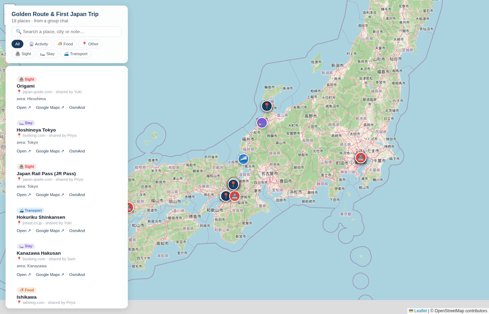

# chatmap

**Turn a group chat into a map.**

You know the pattern: a group chat for a trip, a wedding, a move — months of
conversation, dozens of links pasted at random ("this ryokan!", "this ramen
place!", "this train pass"). Then someone asks *"so where are we actually
going?"* and nobody can find the links.

`chatmap` reads an exported chat, pulls out every link, works out **what** each
link is and **where** it is, and renders an interactive map you can open on your
phone.

```bash
chatmap run ~/history/chat.md -o my-trip --hint Japan
#   → my-trip/locations.geojson
#   → my-trip/index.html        ← open this
```



<sub>Map generated from the fictional two-group chat in [`examples/`](examples/) — 18 places from 24 shared links.</sub>

---

## Why

Chat is where travel planning actually happens, and it's the worst possible
storage for a list of places. Links scroll away, searches miss context, and the
person who shared the place is the only one who remembers why.

`chatmap` converts that stream into a **GeoJSON point set + a static map page**:

- **No account, no server, no API key.** Output is a single HTML file and a
  GeoJSON — host it anywhere, or just open the file.
- **Honest about uncertainty.** Every pin records *how* it was located and how
  precise that is (`high` = coordinates taken from the link itself, `low` = a
  guess from the region name). Nothing pretends to be a precise address.
- **Chat-native metadata.** Each place remembers who shared it, when, and what
  they said about it.
- **Graceful degradation.** A link that can't be geolocated is still listed, so
  nothing silently disappears.

## How it works

```
 chat export          links              places              map
┌──────────────┐   ┌──────────┐   ┌─────────────────┐   ┌────────────┐
│ Signal / txt │──▶│ extract  │──▶│ classify +      │──▶│ locations  │
│ chat.md      │   │ every    │   │ resolve         │   │ .geojson   │
│ data.json    │   │ http URL │   │ coordinates     │   │ + index    │
└──────────────┘   └──────────┘   └─────────────────┘   │   .html    │
                                       │               └────────────┘
                                       │
                    ┌──────────────────┴───────────────────┐
                    │ 1. coordinates embedded in the URL   │ ≤ always free
                    │    (@35.01,135.76  !3d..!4d..  #map=)│
                    │ 2. follow short links                │
                    │    (maps.app.goo.gl, g.co/kgs)      │
                    │ 3. page metadata → place name        │
                    │    (og:title / <title>)             │
                    │ 4. region named on the page          │
                    │    ("Hyogo Prefecture" → centroid)  │
                    │ 5. city in the URL path              │
                    │    (tabelog.com/kyoto/…)            │
                    │ 6. Nominatim (OpenStreetMap)         │
                    └──────────────────────────────────────┘
```

Classification is domain-first (airbnb/booking/mokomoko → **Stay**,
tabelog/hotpepper → **Food**, jreast/hyperdia → **Transport**, …) then falls
back to keywords in the page title.

## Install

Requires Python 3.11+. No third-party dependencies.

```bash
pipx install chatmap          # or: uv tool install chatmap
# or, from a checkout:
git clone https://github.com/alx/chatmap && cd chatmap && uv sync
```

## Quick start

```bash
# 1. See what your chat is holding
chatmap links ~/signal-export/JapanTrip/chat.md

# 2. Build the map
chatmap run ~/signal-export/JapanTrip/chat.md -o out --hint Japan --noindex

# 3. Look at it
python3 -m http.server -d out 8000   # → http://localhost:8000
```

`--hint Japan` is appended to geocoding queries. Use it whenever the chat mixes
countries — it prevents "Osaka Castle" from resolving to a restaurant in Ohio.

### Commands

| Command | Purpose |
|---|---|
| `chatmap links <export...>` | List every link with author + timestamp (`--json` for machines) |
| `chatmap run <export...> -o DIR` | Build `locations.geojson` + `index.html` |

Options for `run`:

| Flag | Meaning |
|---|---|
| `-t, --title` | Map title (shown in the header and page title) |
| `-d, --description` | Meta description |
| `--hint` | Region hint for geocoding, e.g. `"Japan"`, `"Bali"` |
| `--offline` | **No network at all** — only coordinates embedded in URLs |
| `--noindex` | Add `<meta name="robots" content="noindex, nofollow">` |

### Accepted inputs

- `sigexport` markdown — `chat.md` (from [signal-export](docs/exporting-signal.md))
- `sigexport` JSON — `data.json`
- any log of the shape `[YYYY-MM-DD HH:MM] Author: message`
- a directory containing `chat.md` or `data.json`

Multiple exports are merged, so you can feed two related groups at once:

```bash
chatmap run group-a/chat.md group-b/chat.md -o out --hint Japan
```

## Publishing the result

The output is static — anywhere that serves files works.

**GitHub Pages / Netlify / S3:** copy `out/` wherever the site root should be.

**Hugo / Jekyll:** `locations.geojson` matches the schema used by
[maps.girard-davila.net](https://maps.girard-davila.net) (the travel-guide
project), so it can be dropped in as a map's data file unchanged — see
[`docs/publishing.md`](docs/publishing.md).

**Keep it private:** pass `--noindex` and don't link to the page. This is
politeness-level privacy, not security — anyone with the URL can read it.
For a chat with real addresses in it, host behind auth instead.

## What the output looks like

`locations.geojson` — standard GeoJSON, `[longitude, latitude]` order:

```json
{
  "type": "Feature",
  "id": "poi-42572411",
  "geometry": { "type": "Point", "coordinates": [134.860666, 34.914934] },
  "properties": {
    "name": "¥5.3M | 6DK home in Hyogo built in 1982",
    "category": "Stay",
    "icon": "🛏️",
    "url": "https://app.mokomoko.com/property/0f3a1c2d-...",
    "domain": "app.mokomoko.com",
    "notes": "area: Hyogo",
    "shared_by": "Marie",
    "shared_at": "2026-11-02 22:20:00",
    "coord_source": "nominatim",
    "coord_accuracy": "low"
  }
}
```

`_meta` carries the provenance of the whole run — how many links were found, how
many got coordinates, and how many didn't:

```json
"_meta": { "total_features": 18, "total_links": 24, "without_coordinates": 6 }
```

`index.html` is self-contained apart from Leaflet and OpenStreetMap tiles from
CDNs, and includes search, category filters, and per-place links out to Google
Maps / OsmAnd.

## Accuracy, honestly

Some links simply are not places. A flight-comparison homepage, a rail-pass
explainer, an eSIM product page — these get a category but no pin, and they're
counted in `without_coordinates` rather than quietly dropped.

Some links are places only vaguely known. A real-estate listing rendered by
JavaScript tells us the prefecture but not the address, so the pin lands on the
prefecture centroid and is labelled `coord_accuracy: "low"`. Fix these by
editing the coordinates in `locations.geojson` — the map picks them up on reload.

| `coord_accuracy` | Meaning |
|---|---|
| `high` | Coordinates came from the link itself (map URL, data pin) |
| `medium` | Geocoded from a specific place name |
| `low` | Region or city centroid — a hint, not an address |

## Examples

Two fictional chats in [`examples/`](examples/) exercise the whole pipeline:

- [`golden-route/`](examples/golden-route/chat.md) — Tokyo → Kanazawa → Kyoto planning
- [`first-japan-trip/`](examples/first-japan-trip/chat.md) — Osaka → Nara → Tokyo planning

```bash
chatmap run examples/golden-route/chat.md examples/first-japan-trip/chat.md \
  -o examples/out --hint Japan -t "Golden Route & First Japan Trip"
```

Everything in them is invented; the map they produce is real.

## Docs

- **[Exporting your Signal history →](docs/exporting-signal.md)** — step-by-step,
  including key retrieval on Linux, macOS and Windows
- **[Publishing a map](docs/publishing.md)** — static hosts and the travel-guide schema

## Development

```bash
python3 -m pytest -q     # 29 tests, no network required
```

```
src/chatmap/
  parse.py    chat export → Messages (+ link extraction)
  geo.py      links → Places (classification, coordinate resolution)
  render.py   Places → standalone Leaflet page
  cli.py      the `chatmap` command
```

Contribution rules of thumb: the pipeline must never crash on a weird link, and
every coordinate must come with an honest `coord_accuracy`. See
[CONTRIBUTING.md](CONTRIBUTING.md).

## License

MIT
